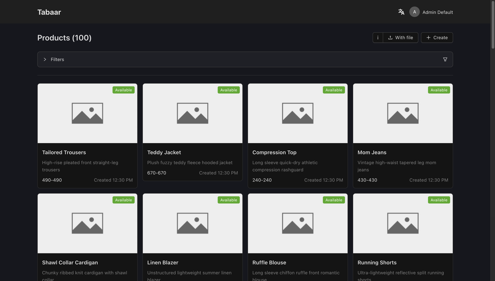

# Tabaar Dashboard



**Tabaar** is a modern, high-performance, open-source Product Information and Catalog Management (PIM) service designed to serve high-throughput e-commerce and multi-channel applications. Built from the ground up to support modern distributed systems, Tabaar simultaneously exposes **REST**, **GraphQL**, and **gRPC** interfaces powered by a hybrid **PostgreSQL** + **Elasticsearch** data architecture and **S3-compatible** media storage.

---

## Quick start

1. Clone the repository.
2. Configure .env file.
3. Install dependencies:

```bash
npm install
```

## Deploy with Docker

1. Copy or create [compose](docker-compose.yml) file.
2. Configurate [.env](.env.example) file with you Tabaar service connection endpoints.
3. Hit commad:

```bash
docker compose up -d
```
